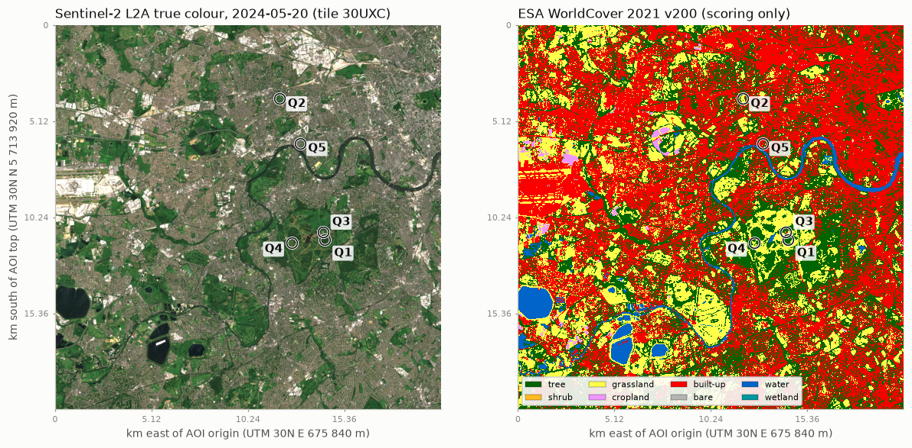
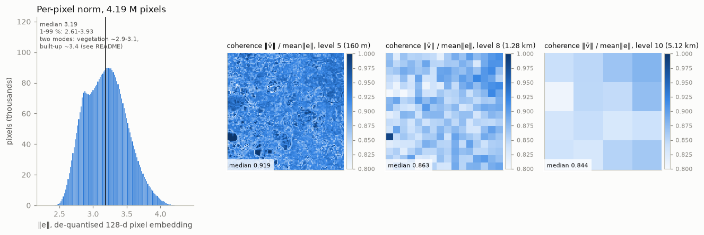
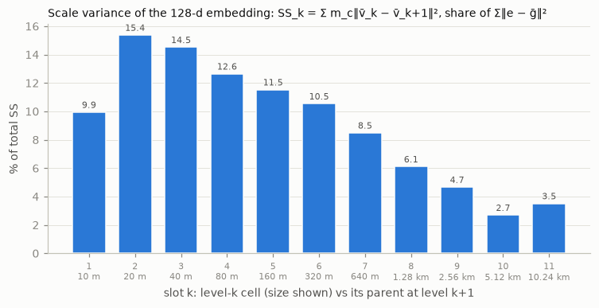
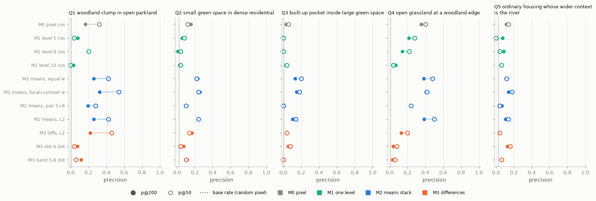
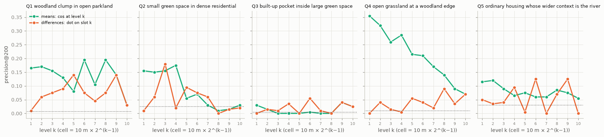
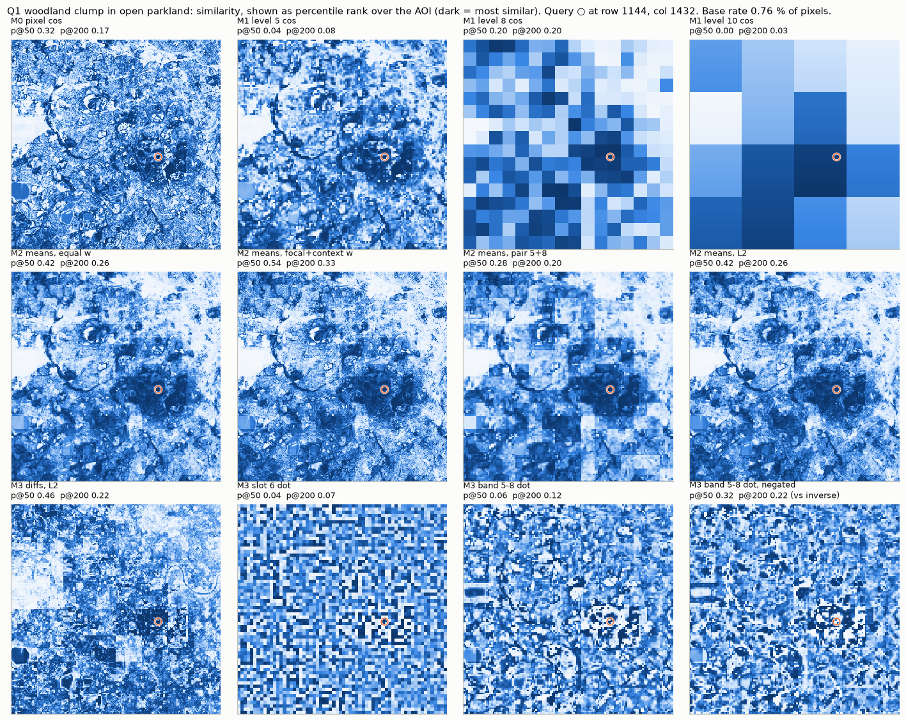
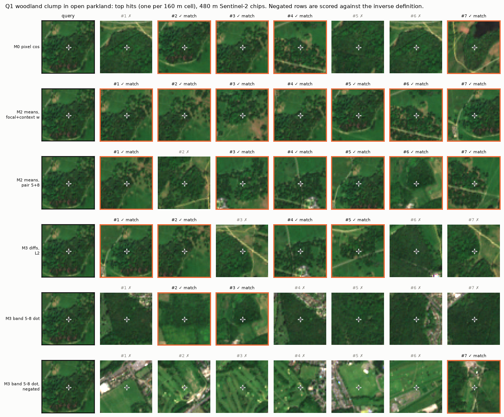

# Experiment 01: a multiscale embedding pyramid for "find places like this", stored as means vs. differences

**Question.** A pixel embedding knows only the context its model gave it. OlmoEarth v1.3
gives each 10 m pixel a 16 × 16 px (≈160 m) window. If we add context outside the model
with a nested dyadic pyramid of mean embeddings, does it matter whether we hold that
pyramid as **means** (what is here at each scale) or as **differences between levels**
(a Laplacian pyramid: how each scale differs from the one above)? The two layouts are
exact linear transforms of each other. The hypothesis was that they carry the same
information but rank similarity differently. The second part of the hypothesis was
that a context pattern such as "woodland clump inside open grassland" can be queried
as a single condition on one difference slot, where the means need two conditions.

**Short answer.** The layouts are equivalent to float precision, and they do rank
differently, in the direction the toy predicts. But on scored precision the **means
stack won on all five queries**. The contrast-only queries on difference slots were
the weakest stacked method, with one exception: the negated contrast, i.e. the
opposite pattern. Verdict: **partly confirmed** (details under [Verdict](#verdict)).



## Data

| | |
|---|---|
| Embeddings | **OlmoEarth v1.3 annual embeddings, year 2024**, all 128 dims (OlmoEarth-v1.3-Base). Store `s3://olmoearth/olmoearth-v1-3-embeddings/embeddings.zarr`, read anonymously through Source Cooperative's S3 proxy (`endpoint=https://data.source.coop`) with `zarr` 3.4 + `obstore`. Array `utm30/embeddings[t=7 (2024), :, 378880:380928, 67584:69632]`. |
| AOI | Exactly one 2048 × 2048 px shard of zone 30 (shard row 185, col 33). EPSG:32630, x 675 840–696 320 m, y 5 693 440–5 713 920 m. Corners 51.549 N −0.464 E (NW) to 51.358 N −0.180 E (SE). Centre 51.454 N, −0.322 E, 3.9 km NW of the Richmond Park centre. The east edge is at −0.169°, so the AOI is entirely in UTM 30N. The square is already on the pixel grid and is shard-aligned, so the read is a single shard. It contains Richmond Park, Bushy Park, Hampton Court, Kew, Wimbledon Common, the Thames from Hampton to Putney, the eastern part of Heathrow, and the reservoirs. |
| Download | 512 MiB int8, 36–49 s. **0 nodata pixels.** |
| Quantisation | Read from the store attributes (`geoemb:quantization`): `method: signed_power`, **`power: 2.0`**, formula `(abs(q) / 127.5) ** 2.0 * sign(q)`, nodata −128, valid range ±127. De-quantised components span ±0.992. Vectors are **not** L2-normalised and were not normalised here. |
| Labels (scoring only) | ESA WorldCover 10 m 2021 v200, `s3://esa-worldcover/v200/2021/map/ESA_WorldCover_10m_2021_v200_N51W003_Map.tif` (read over HTTPS), warped nearest-neighbour onto the embedding grid. Never used as a feature. |
| Imagery (display only) | Sentinel-2 L2A collection 1 true colour, tile 30UXC, 2024-05-20 (Element 84 Earth Search, `s3://e84-earth-search-sentinel-data/sentinel-2-c1-l2a/30/U/XC/2024/5/S2B_T30UXC_20240520T111145_L2A/TCI.tif`). The two July 2024 scenes have cumulus over the south of the AOI. |
| Fallback | AlphaEarth was **not** needed and not used. |

### Per-pixel norms (de-quantised, 4 194 304 pixels)

| | min | 1 % | 25 % | median | 75 % | 99 % | max |
|---|---:|---:|---:|---:|---:|---:|---:|
| 128-d | 2.27 | 2.61 | 2.96 | **3.19** | 3.40 | 3.93 | 4.38 |
| 64-d prefix | 1.84 | 2.15 | 2.45 | **2.62** | 2.79 | 3.17 | 3.53 |

The dataset README quotes a global 128-d range of "about 3.0 to 3.8, median 3.4". This
AOI sits lower. The histogram is **bimodal**, and the modes follow land cover. Median
norm by WorldCover class:

| built-up | tree | water | grassland | cropland |
|---:|---:|---:|---:|---:|
| 3.38 | 3.07 | 3.02 | 2.89 | 2.81 |

So magnitude carries land-cover signal, and cosine discards it.

**Coherence.** For each cell we compute ‖v̄ₖ‖ / mean‖eᵢ‖, a mean resultant length: it is 1
when every pixel in the cell points the same way and falls as the cell mixes.

| level | cell | median | 5–95 % |
|---|---|---:|---:|
| 3 | 40 m | 0.96 | 0.94–0.99 |
| 5 | 160 m | 0.92 | 0.88–0.96 |
| 8 | 1.28 km | 0.86 | 0.82–0.90 |
| 10 | 5.12 km | 0.84 | 0.82–0.87 |
| 12 | whole AOI | 0.84 | – |

Coherence tracks how mixed a cell is. At 160 m, its correlation with the largest
WorldCover class share in the cell is 0.60, and the median is 0.935 in cells ≥ 80 %
one class against 0.893 in cells where no class reaches 50 %. The striking number is the last row. **The AOI grand mean ḡ keeps 84 % of the
average pixel's length** (‖ḡ‖ = 2.67 against a mean ‖e‖ of 3.19). Most of every vector is a
shared offset, so cosine between coarse means is cosine between vectors dominated by ḡ.
Cosines near 1 everywhere make coarse single-level similarity a weak discriminator
(below).



## Method

**Pyramid.** Level 1 is the 10 m pixel. A level-k cell covers 2^(k−1) × 2^(k−1) pixels
and holds the plain count-weighted mean of the valid level-1 vectors under it. Sums and
counts are accumulated upward: a level-k sum is the sum of its children's sums, which
is the base-pixel sum regrouped, never a mean of means. Nothing is renormalised. We
read none of the product's own overviews (it publishes none). There are 12 levels
(10 m … 20.48 km), and level 12 is the single AOI cell, ḡ. Each level is stored at its
own resolution, as float32 means plus int32 counts in `data/pyramid/level_XX.npz`:
2 752 MiB against 2 048 MiB for the float32 base, a ratio of 1.34 (4/3 plus the counts).
In memory, levels ≥ 2 are float64. `Pyramid.diffs(k, top)` derives difference slots on
demand.

The **differences** layout for a stack topped at level K is
slotₖ = v̄ₖ − v̄ₖ₊₁ (k < K) and slot_K = v̄_K − ḡ. All queries use K = 10, so both layouts
hold exactly the same 10 vectors' worth of information, and each is an invertible
linear map of the other.

**Methods**, all on levels 1–10:

| id | what | similarity |
|---|---|---|
| M0 | pixel only (level 1) | cosine |
| M1 k | one pooled level k, k = 2…10 | cosine |
| M2 equal | means stack | Σₖ 0.1 · cos(v̄ₖ(q), v̄ₖ(x)) |
| M2 focal+context | means stack | 0.5 · cos₁ + 0.1 · Σ_{k=6..10} cosₖ. Levels 2–5 (20–160 m) lie inside the model's own 16 × 16 px window, so the pixel vector already encodes them. The context the model cannot see starts at level 6 (320 m). |
| M2 pair 5+8 | "two conditions on the means" at the scoring scales | 0.5 · (cos₅ + cos₈) |
| M2 L2 | means stack, concatenated | −Euclidean (this is the toy's "raw" metric) |
| M3 L2 | differences stack, concatenated | −Euclidean |
| M3 slot 6 | contrast-only, one dyadic slot (320 m vs 640 m, the middle of the 160 m → 1.28 km span) | dot product, and its negative |
| M3 band 5–8 | contrast-only, v̄₅ − v̄₈ = slot₅ + slot₆ + slot₇ (160 m vs 1.28 km) | dot product, and its negative |

Similarity on means uses cosine. Difference slots use only dot products or Euclidean
distance, never cosine. All methods reduce to per-level matrix products with about 20
probe vectors, because a slot is linear in the means (`methods.py`; checked against
brute force in `tests/test_methods.py`).

**Scoring.** The queries, the WorldCover match definitions and every method parameter
were fixed in [`pyramid_sim/queries.py`](pyramid_sim/queries.py) and committed before
any similarity map was computed (commit `48f61c5`). The exemplars were chosen from
WorldCover and the Sentinel-2 image only, and each satisfies its own definition.
Shares are over **centred** windows: s16 = 16 × 16 px (160 m), s128 = 128 × 128 px
(1.28 km). These windows deliberately do not follow the dyadic grid, so the pyramid gets
no free alignment.

Hits are thinned to one per 160 m dyadic cell (16 384 cells); each cell is represented
by its best pixel. Ties are broken at random with a fixed seed. Ties matter for coarse
single-level methods, which are constant over many cells. The query's own 160 m cell is
excluded. The negated contrast queries are scored against a pre-registered "inverse"
definition.

| query | exemplar (row, col; lat, lon) | match definition | inverse (for negated contrast) |
|---|---|---|---|
| Q1 woodland clump in open parkland | 1144, 1432; 51.4415 N, −0.2636 E. Plantation (~300 × 500 m) in grassland ~400 m S of White Lodge, Richmond Park | pixel tree; s16 tree ≥ 50 %; s128 grass + crop ≥ 50 % | clearing in woodland: pixel grass/crop; s16 grass + crop ≥ 50 %; s128 tree ≥ 50 % |
| Q2 small green space in dense residential | 392, 1192; 51.5098 N, −0.2941 E. Small park (~200 × 400 m) among terraced streets, Ealing | pixel grass; s16 grass + tree ≥ 50 %; s128 built-up ≥ 50 % | = Q3 definition |
| Q3 built-up pocket inside large green space | 1103, 1422; 51.4452 N, −0.2649 E. White Lodge buildings, Richmond Park | pixel built-up; s16 built-up ≥ 25 %; s128 green (tree, shrub, grass, crop, wetland) ≥ 80 % | = Q2 definition |
| Q4 open grassland at a woodland edge | 1160, 1256; 51.4407 N, −0.2890 E. Grass beside Spankers Hill Wood, Richmond Park | pixel grass; s16 grass ≥ 25 % and tree ≥ 25 %; s128 tree ≥ 25 % and built-up ≤ 10 % | woodland at a grass edge: pixel tree; same s16; s128 grass ≥ 25 % and built-up ≤ 10 % |
| Q5 ordinary housing whose wider context is the river | 630, 1300; 51.4881 N, −0.2799 E. Terraces ~200 m from the Thames, Strand-on-the-Green | pixel built-up; s16 built-up ≥ 50 % and water = 0; s128 water ≥ 5 % | water inside a built area: pixel water; s16 water ≥ 50 %; s128 built-up ≥ 30 % |

Q3's threshold of s16 built-up ≥ 25 % is low because White Lodge reaches only 29 %
built-up in a centred 160 m window.

## Validation (all pass)

| check | result |
|---|---|
| Reconstruction eᵢ = ḡ + Σₖ slotₖ(i), stacks topped at 12 and at 10 | max abs error **3.3e-16** and **2.2e-16** (components are O(1)) |
| Closure Σᵢ‖eᵢ − ḡ‖² = Σₖ Σ_c m_c‖v̄_c − v̄_parent‖², tops 12 and 10 | relative error **1.5e-15** and **1.7e-15** (target 1e-9). Total SS = 13 236 586 over 4 194 304 pixels |
| `scalevar.scale_variance_raster` (v0.1.1 @ `db3ae33`, mean, base factor 2) on dims 0, 17, 63, 64, 127 of a 256 × 256 sub-AOI (rows 1024–1279, cols 1280–1535, Richmond Park), per-level SS summed over the dims, vs. our vector SS restricted to those dims | all 9 levels agree, max relative error **5.1e-15** (64-d run: 1.3e-14). E.g. level 5: 1544.3807 vs 1544.3807 |
| Toy (test `tests/test_toy.py`) | raw L2 to A: B 0.16, C 1.14, E 1.90, D 2.10; diff L2: B 0.26, E 1.21, C 1.51, D 2.45; level-2 diff dot with A: B 0.90, C 0.08, E −0.15, D −1.20. All match the brief. |

The test suite has 15 tests, including synthetic pyramids with nodata and brute-force
checks of every shortcut similarity: `uv run pytest`.

**Scale variance of the embedding.** Share of total SS by slot (stack topped at 12):

| slot | 10 m | 20 m | 40 m | 80 m | 160 m | 320 m | 640 m | 1.28 km | 2.56 km | 5.12 km | 10.24 km |
|---|---:|---:|---:|---:|---:|---:|---:|---:|---:|---:|---:|
| % SS | 9.9 | **15.4** | 14.5 | 12.6 | 11.5 | 10.5 | 8.5 | 6.1 | 4.7 | 2.7 | 3.5 |

Only 9.9 % of the variance is pixel-to-pair (10 m vs 20 m). That fits an encoder that
works at 20 m and emits at 10 m. The peak is at 20–40 m. A third of the variance (36.0 %)
sits between 320 m and 10 km, beyond the model's window. That is the room a pyramid has
to add information.



## Results

### Precision (128 dims)

precision@200 (p@50 in brackets). The base rate is the share of all pixels that satisfy
the definition. **Bold** marks the best per query among the pre-registered methods.

| method | Q1 clump in parkland | Q2 green in residential | Q3 built in green | Q4 grass at wood edge | Q5 housing near river |
|---|---:|---:|---:|---:|---:|
| *base rate* | *0.008* | *0.025* | *0.004* | *0.009* | *0.030* |
| M0 pixel cos | 0.17 (0.32) | 0.15 (0.12) | 0.03 (0.06) | 0.35 (0.40) | 0.12 (0.14) |
| M1 level 5 (160 m) | 0.08 (0.04) | 0.06 (0.08) | 0.00 (0.00) | 0.21 (0.28) | 0.07 (0.00) |
| M1 level 8 (1.28 km) | 0.20 (0.20) | 0.01 (0.04) | 0.00 (0.00) | 0.14 (0.22) | 0.09 (0.04) |
| M1 level 10 (5.12 km) | 0.03 (0.00) | 0.03 (0.04) | 0.03 (0.04) | 0.07 (0.04) | 0.06 (0.06) |
| M2 means, equal w | 0.26 (0.42) | 0.23 (0.22) | 0.13 (**0.20**) | 0.38 (0.48) | 0.11 (0.12) |
| **M2 means, focal+context** | **0.33 (0.54)** | **0.26 (0.24)** | **0.15** (0.18) | **0.41** (0.42) | **0.14 (0.18)** |
| M2 means, pair 5+8 | 0.20 (0.28) | 0.10 (0.10) | 0.01 (0.00) | 0.23 (0.24) | 0.07 (0.04) |
| M2 means, L2 | 0.26 (0.42) | 0.23 (0.24) | 0.10 (0.14) | 0.39 (**0.50**) | 0.10 (0.14) |
| M3 diffs, L2 | 0.22 (0.46) | 0.17 (0.14) | 0.04 (0.04) | 0.13 (0.20) | 0.04 (0.04) |
| M3 slot 6, dot | 0.07 (0.04) | 0.07 (0.04) | 0.06 (0.08) | 0.04 (0.08) | 0.12 (0.16) |
| M3 band 5–8, dot | 0.12 (0.06) | 0.12 (0.10) | 0.01 (0.00) | 0.03 (0.06) | 0.07 (0.06) |
| *inverse base rate* | *0.011* | *0.004* | *0.025* | *0.008* | *0.006* |
| M3 slot 6, negated (vs inverse) | 0.10 (0.26) | 0.01 (0.00) | 0.04 (0.02) | 0.04 (0.06) | 0.01 (0.00) |
| M3 band 5–8, negated (vs inverse) | **0.22 (0.32)** | 0.04 (0.00) | 0.04 (0.02) | 0.01 (0.02) | 0.00 (0.00) |



**Robustness.**
- **Stricter self-match exclusion.** This was added after the first run, and it is not
  pre-registered. In the hit chips, the top means-stack hits for Q3 (and some for Q1)
  were neighbouring 160 m cells of the query's own feature. We therefore also excluded
  every cell within 640 m of the query. p@200 for M0 / M2 focal+context / M2 L2 /
  M3 L2 / M3 band:
  - Q1: 0.09 / **0.23** / 0.18 / 0.14 / 0.09
  - Q2: 0.14 / **0.24** / 0.22 / 0.17 / 0.12
  - Q3: 0.02 / **0.14** / 0.10 / 0.03 / 0.01
  - Q4: 0.32 / 0.38 / **0.39** / 0.11 / 0.03
  - Q5: 0.09 / 0.10 / 0.07 / 0.03 / 0.07, and **0.12** for M3 slot 6

  Q1 loses the most: about half of the pixel baseline's matching Q1 hits lay within
  640 m of the query, i.e. in its own plantation. The ranking is unchanged except on Q5, where the single slot-6 dot (0.12)
  edges past the means stack (0.10). The negated Q1 band holds at 0.23.
- **64-dim Matryoshka prefix.** The full pipeline, rerun on dims 0–63, gives the same
  ordering. M2 focal+context p@200 is 0.32 / 0.27 / 0.17 / 0.34 / 0.12, M3 L2 is
  0.21 / 0.17 / 0.04 / 0.12 / 0.06, and M0 is 0.15 / 0.15 / 0.04 / 0.28 / 0.10. The full
  tables are in [`results/tables.md`](results/tables.md).
- **Which slot?** Slot 6 was fixed in advance. Afterwards, every single slot k = 1…10
  was scored (fig 7 and `tables.md`). The best slot per query, chosen post hoc, reaches
  p@200 0.14 (Q1, slot 5 or 9), 0.18 (Q2, slot 3), 0.06 (Q3), 0.09 (Q4) and 0.12 (Q5).
  Even with that hindsight it does not reach M2 focal+context on Q1–Q4. Part of the
  reason is the dyadic grid. The Q1 exemplar's own contrast energy ‖slotₖ‖² is 1.47 at
  slot 5 but 0.12 at slot 6, so which slot "encodes the pattern" depends on where the
  plantation falls relative to the cell boundaries.



### Do the layouts rank alike?

No. For the same query, the top-200 cells of the means stack and of the differences
stack (both Euclidean) overlap with Jaccard 0.39 / 0.33 / 0.07 / 0.27 / 0.11 (Q1–Q5).
Spearman's ρ over all 16 384 cells is 0.35 / 0.29 / 0.36 / 0.37 / 0.73. Equal-weight
cosine on means gives almost the same numbers as means-L2. The direction of the
difference is the one the toy predicts. For Q1, here are the top-200 hits by their
dominant class at 160 m / 1.28 km:

| top 200 for Q1 | island (tree / open) | forest interior (tree / tree) | clearing (open / tree) | open grassland (open / open) | other |
|---|---:|---:|---:|---:|---:|
| M0 pixel | 40 | 158 | 0 | 0 | 2 |
| M2 means, L2 | 57 | 143 | 0 | 0 | 0 |
| M3 diffs, L2 | 53 | 124 | 3 | **17** | 3 |
| M3 band 5–8 | 33 | 143 | 1 | 2 | 21 |
| M3 band 5–8, negated | 1 | 10 | **97** | 57 | 35 |

As in the toy, both stacks put the islands near the top. On p@50 the differences stack
is ahead of the equal-weight means stack (0.46 vs 0.42), though not of the
focal + context weighting (0.54). Below that, the means' errors are **forest interior**. The
differences stack trades some forest interior for **open grassland**, places with no
trees at all whose contrast across scales resembles the query's. That is the toy's
second-place disagreement, reproduced at real scale. In this AOI it costs precision:
open grassland is never a match.

### Per-query maps and hits

Similarity maps (12 methods each; percentile rank over the AOI, dark = most similar) and
the top-7 hit chips per method:

| | maps | hits |
|---|---|---|
| Q1 | [fig4_maps_Q1](results/figures/fig4_maps_Q1.png) | [fig5_hits_Q1](results/figures/fig5_hits_Q1.png) |
| Q2 | [fig4_maps_Q2](results/figures/fig4_maps_Q2.png) | [fig5_hits_Q2](results/figures/fig5_hits_Q2.png) |
| Q3 | [fig4_maps_Q3](results/figures/fig4_maps_Q3.png) | [fig5_hits_Q3](results/figures/fig5_hits_Q3.png) |
| Q4 | [fig4_maps_Q4](results/figures/fig4_maps_Q4.png) | [fig5_hits_Q4](results/figures/fig5_hits_Q4.png) |
| Q5 | [fig4_maps_Q5](results/figures/fig4_maps_Q5.png) | [fig5_hits_Q5](results/figures/fig5_hits_Q5.png) |




What the maps and chips show:

- **Q1.** The means stack concentrates on the big parks. M0 lights up every wooded
  pixel, including suburban tree cover.
  The positive band contrast mostly finds dense woodland whose 1.28 km cell is
  *less* wooded: woodland next to housing as well as next to grass. A dot product
  rewards a large contrast in the right direction regardless of the absolute state.
  The negated band finds **golf courses and playing fields inside wooded suburbs**.
  These are real "clearings", and 97 of the 200 are tree-dominated at 1.28 km, but many
  fail the strict 50 %-tree-at-1.28 km test.
- **Q2.** Small parks and playing fields among terraces come up well under the means
  stack (p@200 0.26, ten times the base rate). Pure pixel cosine returns any grass.
- **Q3.** This is the hardest query: only 452 of 16 384 cells contain any match pixel.
  The White Lodge pixel's own 160 m window is mostly tree and grass (dominant class at
  160 m: tree), so the 10 m embedding looks like parkland. The means stack still gets
  5× the pixel baseline. Its first matches, beyond White Lodge's own neighbouring cells,
  are other small building groups in Richmond Park and near Petersham/Ham. The
  difference contrasts fail (0.01–0.06).
- **Q4.** The pixel itself is already a strong signal (M0 0.35), and the means stack
  adds little (0.41). The differences stack drops to 0.13, and its hits share the
  query's dominant class at 1.28 km less often (0.47 vs 0.56 for the means L2).
- **Q5.** Every method is weak, at 2–5× the base rate. The 5 % water share at 1.28 km
  shifts a 128-d mean very little. Most hits are ordinary terraced streets with no river
  in their 1.28 km window. The negated contrasts return large bright roofs (retail and
  industrial), not water. That suggests Q5's contrast vector is dominated by
  differences among built-up types rather than by the river.

## Verdict

**Partly confirmed.**

1. *Same information:* **confirmed**, exactly. Each layout reconstructs the other to
   3e-16, and the scale-variance closure holds to 1.6e-15.
2. *They rank similarity differently:* **confirmed**. Top-200 overlap between the two
   stacks is Jaccard 0.07–0.39 and cell-rank correlation is 0.29–0.73. The direction is
   the one the toy predicts: the means confuse the pattern with *same state* (forest
   interior), the differences with *same contrast* (open grassland, 17/200 for Q1).
3. *A context pattern is better expressed as one condition on a difference slot:*
   **not confirmed** in this test.
   - The pre-registered single slot (p@200 0.04–0.12) and the 160 m vs 1.28 km band
     (0.01–0.12) beat the pixel baseline only on Q3 (slot 6) and Q5 (tie).
   - The means stack with focal + context weights won 5/5 queries at p@200: 0.33 /
     0.26 / 0.15 / 0.41 / 0.14 against M0's 0.17 / 0.15 / 0.03 / 0.35 / 0.12.
   - "Two conditions on the means" at the same two scales (M2 pair 5+8) did no better
     than the band contrast overall: it won on Q1 and Q4 (0.20 vs 0.12, 0.23 vs 0.03),
     lost on Q2 (0.10 vs 0.12) and tied on Q3 and Q5. Both were far below the full
     weighted stacks.

   The one place the contrast layout earned its keep is the **opposite pattern**. Negating
   the Q1 band query found clearings with 20× the base-rate precision (0.22 vs 0.011)
   and, among the misses, plenty of golf courses and playing fields in woodland. The
   means layout has no equivalent single operation.

So the differences layout is a good *index of contrasts*, but on its own it is a poor
*search key*. Context search works best when the query pins both the state at each
scale and the scale structure, and a weighted means stack does that.

## What each layout does better

**Means.**
- Matches *state* at every scale, which is what these WorldCover definitions score.
- Cosine per level is scale-free, and the weights are easy to reason about. The focal +
  context weighting, chosen in advance, was the best method on 5/5 queries at p@200
  (3/5 under the stricter 640 m exclusion, where means-L2 wins Q4 and slot 6 wins Q5).
- Less sensitive to the dyadic grid than single slots. In fig 7, precision by level
  changes smoothly for the means and zigzags for the slots.

**Differences.**
- Express a *signed contrast*, so "the opposite pattern" is one negation (Q1: 20× base
  rate).
- Invariant to the large shared offset ḡ (84 % of the average pixel norm) everywhere
  except the top slot.
- Make the scale-variance accounting explicit. ‖slotₖ‖² per cell is the
  Moellering–Tobler element, so the same store gives a variance-by-scale map for free
  (fig 3).
- On Q1 p@50, the differences stack ranked the islands slightly better than the means
  (0.46 vs 0.42).

## Limitations

- **Pooling loses arrangement within a cell.** A 160 m cell half woodland on its west
  side and one with scattered trees have the same mean.
- **Dyadic cells are not centred on the query.** A pattern's contrast lands in
  different slots depending on where it falls relative to cell boundaries (Q1: slot 5
  vs 6 energy 1.47 vs 0.12). The slot maps (fig 4, M3 slot 6) are visibly blocky
  checkerboards. The scoring uses centred windows, so this misalignment costs the
  pyramid honestly.
- **Fine levels are blurred by the model's own 160 m window.** Pixel-to-pair variance is
  only 9.9 % of the total, and levels 2–5 repeat what the pixel vector already saw. This
  is why the focal + context weights skip them.
- **WorldCover cannot express several patterns.**
  - It is from 2021 against 2024 embeddings.
  - Suburban gardens and street trees are mapped as tree/grass, so "dense residential"
    is only ≥ 50 % built-up.
  - Golf courses, playing fields and parkland grass are all just "grassland". Q1's
    negated hits are visually right but often fail the test for that reason.
  - "Ordinary housing" (Q5) can only be "built-up", so terraces, offices and retail
    sheds are one class.
  - The thresholds are judgement calls.
- **Small samples.** There is one exemplar per query, one AOI, one year and one
  tie-break seed. The cells with any match pixel number 424 / 2386 / 452 / 741 / 1318,
  so p@200 has a ceiling of 1 in every case, but differences of ±0.03 are within noise.
- The **640 m self-exclusion** metric was added after looking at the first results. It
  is reported as a sensitivity check, not as the primary score.
- Cosine on means discards the norm, which carries land-cover signal (built-up 3.38 vs
  grass 2.89).

## Next steps (out of scope here)

- Grid-origin shifting or centred (sliding) windows, to remove the dyadic alignment
  effect.
- Cosine on ḡ-centred means.
- Weights or slot combinations learned from a handful of labelled examples, instead of
  fixed in advance.
- Multi-exemplar queries.
- The same comparison on AlphaEarth (1.28 km tiles, unit-norm vectors).
- Clustering pyramid vectors into habitat or landscape types, and ecological or bird
  models using the pyramid as covariates.
- Running a model natively at coarser scales and comparing it with the pooled pyramid.

## Reproduce

```bash
cd experiments/01-pyramid-similarity
uv sync
uv run pytest                        # 15 tests, < 2 s
uv run python -m pyramid_sim.run     # download (~600 MB) -> pyramid -> validation -> 128-d and 64-d queries -> figures + tables
```

A clean run from an empty cache took about 27 min on a 4-core, 8 GB VM. It is all
in-memory numpy, no Dask, and fits in that VM's 8 GB (peak memory was not measured).
Downloads and the pyramid go to `data/` (gitignored, 3.3 GB). Results go to `results/`: `results_128d.json`, `results_64d.json`,
`tables.md` and `figures/`.

Layout:

| file | contents |
|---|---|
| `pyramid_sim/config.py` | AOI and source paths |
| `fetch.py` | reads and caches the embeddings, WorldCover and Sentinel-2 |
| `pyramid.py` | `Pyramid`, `diffs()`, reconstruction, closure, coherence |
| `queries.py` | the pre-registration |
| `methods.py` | similarity maps |
| `scoring.py` | WorldCover windows, thinning, precision |
| `toy.py` | the 2-D toy |
| `run.py`, `figures.py`, `report.py` | the pipeline, figures and tables |

## Attribution and license

Embeddings: **OlmoEarth v1.3 Embeddings**, © The Allen Institute for Artificial
Intelligence (Ai2), released under the
[OlmoEarth Artifact License](https://data.source.coop/olmoearth/olmoearth-v1-3-embeddings/LICENSE.txt).
Paper: Team OlmoEarth et al. (2026), *OlmoEarth v1.3 Embeddings*, Allen Institute for
AI, https://allenai.org/papers/olmoearth-v1-3. Hosted on
[Source Cooperative](https://source.coop/olmoearth/olmoearth-v1-3-embeddings).

The figures and result files here are derivatives of those embeddings. As the license
requires, they carry its use restrictions (Section 2): they may not be used for
military, defence, intelligence-gathering, surveillance or policing applications, or
for extractive activities such as mining, drilling or deforestation.

ESA WorldCover 10 m 2021 v200 © ESA WorldCover project / contains modified Copernicus
Sentinel data (2021), CC BY 4.0. Sentinel-2 imagery: contains modified Copernicus
Sentinel data (2024).
